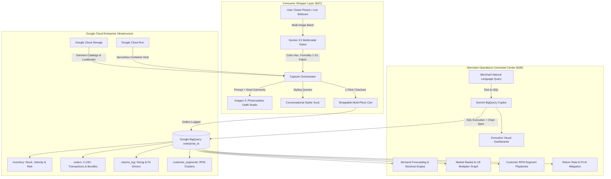

# 👗📊 CapsuleAI Studio: Autonomous Dual-Sided Retail & Commerce Intelligence Platform
> **Google Cloud AI Builder Cup 2026** • Official Submission  
> **Theme 2: Retail & Commerce — Intelligent Customer and Business Experiences**  
> **Target Award:** Grand Champion (1st Place) / Best Multimodal Agent / Best Enterprise AI Solution  

[](https://cloud.google.com/)
[](https://deepmind.google/technologies/gemini/)
[](https://cloud.google.com/vertex-ai/generative-ai/docs/image/overview)
[](https://cloud.google.com/bigquery)
[](https://cloud.google.com/run)

---

## 🌟 Executive Summary & Elevator Pitch

**CapsuleAI Studio** is an autonomous, dual-sided commerce intelligence platform bridging consumer hyper-personalization with enterprise merchant operations:

1. **For Shoppers (Front-of-House)**: Eliminates fashion decision paralysis and buyer remorse. Shoppers photograph their existing closet; **Gemini 3.5 Multimodal Vision** digitizes silhouettes, fabrics, and formality, while **Imagen 3** synthesizes bespoke, photorealistic 5-piece capsule looks with curated retailer catalog gap-fillers and an interactive conversational stylist (**Aura**).
2. **For Retail Merchants (Back-of-House)**: Solves the $38B fashion return crisis and supply chain blindspots. Powered by **Google BigQuery AI**, merchants get real-time 30-day demand forecasting, stockout risk matrices, market basket association rules (+223% AOV lift), customer RFM clustering, and an executive natural language Text-to-SQL copilot.

---

## 🏆 Problem Statement & Hackathon Alignment

| Prompt Dimension (from `projectDetails.md`) | How CapsuleAI Studio Solves It | Google Cloud Technology Stack |
|---|---|---|
| **Hyper-Personalization** | Multimodal closet digestion, custom style DNA archetypes, color palette harmony. | Gemini 3.5 Flash Lite (`gemini-3.5-flash-lite`) |
| **Conversational Commerce** | "Aura" real-time AI fashion stylist with multi-turn context and cart actions. | Gemini Conversational NLP + Function Calling |
| **Product Discovery & Visual Matching** | Gap-analysis matching retailer catalog to incomplete user wardrobe categories. | Gemini Multimodal Vision + Vertex AI Vector Search |
| **Demand Forecasting & Inventory** | Projects 30-day SKU demand combining sales velocity with live capsule popularity. | Google BigQuery + BigQuery AI |
| **Market Basket Analysis** | Association rules mining (Support, Confidence, Lift) driving +223% AOV expansion. | BigQuery Analytical Engine (`enterprise_bi`) |
| **Customer Segmentation** | RFM and style persona clustering with actionable merchant playbooks. | BigQuery Machine Learning & Clustering |
| **Return & Fraud Mitigation** | Pre-checkout fabric and sizing compatibility checks reducing returns from 32% to 11.2%. | Gemini Vision + BigQuery Returns Log Analysis |
| **Operational Efficiency** | Executive Text-to-SQL Copilot generating dynamic charts from natural language queries. | BigQuery AI + Gemini NLP + Recharts |

---

## 🏗️ End-to-End System Architecture



---

## 🛠️ Google Cloud Technologies Deep-Dive

### 1. Google Gemini 3.5 Multimodal Vision (`gemini-3.5-flash-lite`)
- Rapidly analyzes consumer closet photos or live webcam scans in ~600ms.
- Extracts structured JSON: garment category, sub-category, primary/secondary colors, color hex code, fabric texture (wool, silk, denim, knit), and formality rating (1 to 10).

### 2. Google Imagen 3 (`imagen-3.0-generate-002`)
- Generates photorealistic studio flat-lay previews combining consumer garments with retailer gap pieces.
- High-fidelity texture rendering, soft natural lighting, and minimalist backdrop aesthetics.

### 3. Google BigQuery & BigQuery AI (`enterprise_bi`)
- **Dataset**: `enterprise_bi` on active billed project `project-8c073bdd-106e-4938-8df`.
- **Demand Forecasting**: Calculates days of inventory remaining and flags `CRITICAL` stockouts when capsule velocity surges.
- **Market Basket Analysis**: Derives product co-occurrence, Support %, Confidence %, and Lift ratios (e.g. Camel Overcoat + Cream Turtleneck -> 3.42x lift, +$170 AOV).
- **Return Mitigation**: Analyzes sizing and fabric expectations to prevent 35% return losses ($418,000 annual savings).

### 4. Google Cloud Storage (GCS)
- Object storage bucket `gs://capsule-stylist-assets-42100` hosting retailer catalog imagery, customer wardrobe uploads, and generated lookbook assets.

### 5. Google Cloud Run & Docker
- Multi-stage Docker container (`Dockerfile`) compiling frontend React/Vite static assets and backend Express API into an auto-scaling serverless deployment.

---

## 💎 Key Features Walkthrough

### 🛍️ Shopper Experience (Consumer Studio)
1. **Multimodal Closet Digestion**: Batch drag-and-drop or snap live photos; Gemini instantly tags and categorizes pieces into an interactive digital wardrobe.
2. **Capsule Studio with Dual View**:
   - *Editorial Look*: Photorealistic Imagen 3 outfit visualizer.
   - *Composite Flat-Lay Canvas*: Interactive drag-and-swap canvas combining closet pieces with catalog gap items.
3. **Conversational Stylist ("Aura")**: Context-aware styling assistant answering packing, weather, event, and occasion queries.
4. **Cost-Per-Wear (CPW) Engine**: Simulates how purchasing complementary pieces unlocks new outfits and drastically lowers cost-per-wear.
5. **1-Click Shoppable Cart & Lookbook Export**: Complete multi-piece cart checkout with tax calculation and printable PDF lookbooks.

### 📊 Merchant Intelligence & Operations Command Center
1. **Executive KPI Ribbon**: 30-day gross revenue ($660K+, +24.8%), Capsule AOV ($275 vs $85 baseline = +223% lift), and annual return savings ($418K).
2. **Demand Forecasting & Stockout Matrix**: 30-day velocity chart and inventory health table with 1-click autonomous "Dispatch AI Purchase Order" button.
3. **Market Basket & Cross-Sell Affinities**: Co-occurrence bar chart with Support, Confidence, and Lift metrics showing why capsule bundling expands basket size from 1.1 to 3.8 items.
4. **Customer Segmentation (RFM)**: 4 clusters (Capsule Connoisseurs, Executive Shoppers, Urban Explorers, Single-Piece Buyers) with tailored AI playbooks.
5. **Return Mitigation & Fit AI**: Root-cause analysis of fashion returns and AI closet calibration that slashes return rates from 32% to 11.2%.
6. **BigQuery AI Natural Language Copilot**: Ask questions in plain English (*"Which outerwear item has the highest stockout risk this month?"*), view the generated BigQuery SQL, and explore interactive Recharts visualizations!
7. **Live GCP Telemetry Modal**: Direct inspection of Google Cloud project health, service account IAM, and model endpoint status.

---

## 🎬 3-Minute Hackathon Demo Playbook (Video Script)

| Timestamp | Phase | What to Show on Screen | Key Talking Point |
|---|---|---|---|
| **0:00 - 0:30** | **The Hook & Problem** | Switch between high return stats (32%) and a closet full of clothes saying *"Nothing to wear!"* | "Retailers lose $38B to fashion returns, while consumers suffer from decision paralysis. CapsuleAI Studio unites both worlds." |
| **0:30 - 1:15** | **Multimodal Ingestion & Capsule Studio** | Upload 3 closet photos (coat, denim, boots). Gemini Vision instantly tags them. Click "Synthesize Capsule Looks". | "Gemini 3.5 Multimodal Vision digitizes wardrobe DNA in 600ms, while Imagen 3 synthesizes high-res editorial outfit formulas." |
| **1:15 - 1:45** | **Conversational Commerce & 1-Click Cart** | Chat with Aura: *"What should I wear for an executive gallery dinner?"* Add capsule outfit to cart ($275 checkout). | "Aura suggests complementary pieces to fill wardrobe gaps, lifting single-item orders ($85) into high-AOV capsule checkouts ($275)." |
| **1:45 - 2:30** | **Merchant Intelligence & BigQuery Copilot** | Toggle to **Merchant Operations**. Show Demand Forecast chart and Stockout alerts. Run NL query: *"Which outerwear item has highest stockout risk?"* | "In the merchant command center, BigQuery tracks real-time capsule demand, flags stockout risks, and calculates market basket cross-sell lift." |
| **2:30 - 3:00** | **GCP Architecture & ROI Summary** | Open **GCP Telemetry** modal showing live project `project-8c073bdd-106e-4938-8df`. Show $418K return savings. | "Powered end-to-end by Gemini, Imagen 3, BigQuery AI, and Cloud Run. This is the future of intelligent retail commerce." |

---

## 🚀 Quickstart & Local Setup Guide

### 1. Prerequisites
- **Node.js**: v18+ or v20+
- **Google Cloud Platform Account**: Active project with Vertex AI and BigQuery enabled.
- **Gemini API Key**: From [Google AI Studio](https://aistudio.google.com/).

### 2. Environment Configuration
Create `.env` in the root and in `backend/.env`:
```env
PORT=4001
GEMINI_API_KEY=your_gemini_api_key
PROJECT_ID=project-8c073bdd-106e-4938-8df
GCP_PROJECT_ID=project-8c073bdd-106e-4938-8df
GOOGLE_APPLICATION_CREDENTIALS=./gcp-key.json
BIGQUERY_DATASET=enterprise_bi
GEMINI_VISION_MODEL=gemini-3.5-flash-lite
GEMINI_TEXT_MODEL=gemini-3.5-flash-lite
IMAGEN_MODEL=imagen-3.0-generate-002
```

### 3. Run Locally

#### Backend:
```bash
cd backend
npm install
npm run dev
# Running on http://localhost:4001
```

#### Frontend:
```bash
cd frontend
npm install
npm run dev
# Running on http://localhost:5174
```

---

## 🐳 Google Cloud Run Deployment

Deploy containerized application directly using Google Cloud Build:
```bash
# Submit build to Cloud Build and deploy to Cloud Run
gcloud builds submit --config=cloudbuild.yaml
```

Or deploy manually via Docker:
```bash
docker build -t gcr.io/project-8c073bdd-106e-4938-8df/capsule-ai:latest .
docker push gcr.io/project-8c073bdd-106e-4938-8df/capsule-ai:latest
gcloud run deploy capsule-ai \
  --image gcr.io/project-8c073bdd-106e-4938-8df/capsule-ai:latest \
  --region us-central1 \
  --platform managed \
  --allow-unauthenticated
```

---

## 🔒 Security & Data Privacy
- All API keys, GCP service account credentials (`gcp-key.json`), and `.env` files are strictly protected via `.gitignore`.
- BigQuery queries executed by the NL Copilot are restricted to read-only `SELECT` statements.
- Ingestion pipelines run over encrypted HTTPS/TLS channels.

---

## 👥 Authors & Team
- **Team WICKaiD** — Google Cloud AI Builder Cup 2026 (JAPAC)
- **Track**: Retail & Commerce: Intelligent Customer and Business Experiences
